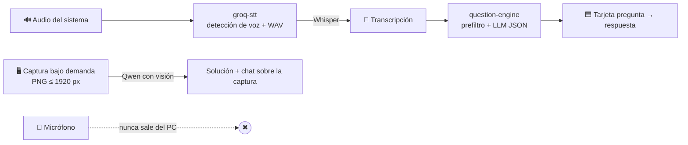

<div align="center">


# Copiloto de sesión

**Escucha tu clase o reunión, detecta las preguntas y las responde solo.**
**Cuando se lo pides, lee tu pantalla y te da la solución.**

<sub>Excel en español · MySQL 8 · Python / pandas · Windows · 100 % gratis con Groq</sub>

<br/>

[](https://github.com/leiderdario/-Copiloto-de-sesion/releases/latest)


-f55036?style=flat-square)


</div>

---

## 📑 Contenido

1. [Qué es](#-qué-es)
2. [Cómo se ve](#-cómo-se-ve)
3. [Instalación rápida (recomendada)](#-instalación-rápida-recomendada)
4. [Clave de Groq](#-clave-de-groq-gratis)
5. [Ejecutar desde el código fuente](#-ejecutar-desde-el-código-fuente)
6. [Uso](#-uso)
7. [Límites de la capa gratuita](#-límites-de-la-capa-gratuita)
8. [Privacidad](#-privacidad)
9. [Cómo funciona](#-cómo-funciona)
10. [Desarrollo](#-desarrollo)
11. [Estado y hoja de ruta](#-estado-y-hoja-de-ruta)
12. [Créditos y licencia](#-créditos-y-licencia)

---

## ✨ Qué es

Un asistente de escritorio para **profesores y consultores de datos**. Mientras das una
clase o atiendes a un cliente:

| | Función | Cómo |
|:-:|---|---|
| 🎧 | **Escucha** el audio del sistema (Teams, Meet, Zoom, un vídeo…) | Transcribe en vivo con Whisper; tú lo pausas cuando quieras |
| 🟦 | **Detecta las preguntas** y las **responde solo** | Cada pregunta en su tarjeta, con la respuesta justo debajo |
| 🖥️ | **Lee tu pantalla** solo cuando tú lo pides | Botón o `Ctrl+Enter` → fórmula, consulta o código, explicado |
| 💬 | **Chat sobre la captura** | Pregunta lo que quieras sobre lo que acaba de leer, y responde al grano |
| 📊 | **Límites en vivo** | Ves cuánta voz e IA te quedan en la capa gratuita |
| 🙈 | **Invisible al compartir pantalla** | El panel no sale en Teams, Meet ni en grabaciones |

> [!IMPORTANT]
> Tu **micrófono nunca sale del PC**. Solo se transcribe lo que dicen los demás (el audio del
> sistema), así que nunca responde a tus propias preguntas.

---

## 👀 Cómo se ve

```
┌─ 🎧 ESCUCHA ─ ● Escuchando  [ES][EN] [⏸ Pausar] [🧹] ┬─ 🖥️ PANTALLA ─────────────── [🧹] ┐
│ Voz esta hora ████████░ quedan 1 h 59 min           │ **Respuesta:**                     │
│ Voz hoy       █████████ quedan ≈7 h 40 min          │ WITH ventas_cliente AS ( ... )     │
│ IA hoy        █████████ quedan 987 de 1000          │ **Por qué:** …                     │
│ ┌─────────────────────────────────────────────┐     │                                    │
│ │ 🟦 PREGUNTA · 10:42                      #3 │     │ **❓ ¿Y si el cliente no compró?** │
│ │ ¿Cómo saco el total por región de este año? │     │ No aparece: el JOIN lo excluye…    │
│ │ ─ ─ ─ ─ ─ ─ ─ ─ ─ ─ ─ ─ ─ ─ ─ ─ ─ ─ ─ ─ ─ ─ │     │                                    │
│ │ GROUP BY region con WHERE YEAR(fecha)=2026… │     │                                    │
│ │ ▸ ver detalle                               │     │                                    │
│ └─────────────────────────────────────────────┘     │                                    │
│ ▾ Transcripción en vivo (42)                        │ [Pregunta sobre la captura…] [⚡]  │
└─────────────────────────────────────────────────────┴────────────────────────────────────┘
```

- **Izquierda, lo que se oye:** la pregunta más reciente arriba y resaltada.
- **Derecha, lo que se ve:** solo actúa cuando tú lo pides.
- **Nunca se mezclan.**

---

## 🚀 Instalación rápida (recomendada)

> Para usarlo en cualquier PC con Windows. **No necesitas instalar Node.js ni nada más.**

1. **Descarga** `Copiloto-de-sesion-Setup.exe` desde
   [**Releases**](https://github.com/leiderdario/-Copiloto-de-sesion/releases/latest).
2. **Ábrelo.** Se instala solo en unos segundos y crea un acceso directo en el escritorio y en el menú Inicio.
3. Si Windows muestra **“Windows protegió tu PC”** (pasa con programas sin firma digital):
   pulsa **Más información → Ejecutar de todas formas**.
4. **Configura tu clave de Groq** (siguiente sección) y pulsa **Start Session**.

<details>
<summary><b>Desinstalar</b></summary>

Configuración de Windows → Aplicaciones → *Copiloto de sesion* → Desinstalar.

</details>

---

## 🔑 Clave de Groq (gratis)

El copiloto usa la capa **gratuita** de [Groq](https://console.groq.com). No pide tarjeta.

1. Crea una cuenta en **[console.groq.com](https://console.groq.com)** → **API Keys** → **Create API Key**.
2. Guárdala en el copiloto de **una** de estas dos formas:

| Opción | Cómo | Ventaja |
|---|---|---|
| **A. Variable de entorno** (recomendada) | Abre **PowerShell** y ejecuta la línea de abajo. Después cierra y vuelve a abrir el copiloto | La clave no se guarda en ningún archivo |
| **B. En la app** | Pantalla de inicio → **AI responses** → **GROQ API KEY** → pégala | Más rápido |

```powershell
[Environment]::SetEnvironmentVariable('GROQ_API_KEY', 'pega-aqui-tu-clave', 'User')
```

> [!TIP]
> Los límites de Groq son **de la cuenta, no de la clave**, y se recargan de forma continua.
> No hace falta crear claves nuevas.

> [!WARNING]
> Nunca subas tu clave a GitHub ni la pegues en chats. Si se filtra, revócala en
> console.groq.com y crea otra.

---

## 🛠️ Ejecutar desde el código fuente

> Para quien quiera modificar el código o no quiera usar el instalador.

### Opción 1 · Doble clic (automático)

1. Descarga el repositorio: **Code → Download ZIP**, y descomprímelo (o usa `git clone`, abajo).
2. Haz doble clic en **`Iniciar Copiloto.bat`**. El archivo:
   - comprueba que tienes **Node.js** y, si falta, ofrece instalarlo con `winget`;
   - **instala las dependencias** la primera vez (1–3 minutos);
   - **abre el copiloto**.

### Opción 2 · Terminal

```powershell
git clone https://github.com/leiderdario/-Copiloto-de-sesion.git
cd -Copiloto-de-sesion
npm install
npm start
```

<details>
<summary><b>Requisitos</b></summary>

| Herramienta | Versión |
|---|---|
| Windows | 10 u 11 |
| [Node.js](https://nodejs.org) | 20 LTS o superior (probado con 22.16) |
| git | Opcional (solo para `git clone`) |

</details>

<details>
<summary><b>Crear tu propio instalador <code>.exe</code></b></summary>

```powershell
npm run make
```

El instalador queda en `out/make/squirrel.windows/x64/Copiloto-de-sesion-Setup.exe`.

</details>

---

## 🎯 Uso

### Durante la sesión

| Acción | Cómo |
|---|---|
| ▶️ Empezar | **Start Session** en la pantalla de inicio |
| ⏸️ Pausar / reanudar la escucha | Botón **⏸ Pausar** en la columna Escucha (en pausa no gasta cupo) |
| 🌐 Idioma de la sesión | **ES** / **EN** en la columna Escucha. En inglés, la pregunta se traduce y la respuesta sale en inglés, lista para decirla |
| 🖥️ Analizar la pantalla | Botón **Analyze Screen** o `Ctrl+Enter` |
| 💬 Preguntar sobre la captura | Escribe en la caja de la columna Pantalla y pulsa Enter |
| 🧹 Limpiar | Cada columna tiene el suyo y **siempre pide confirmación** |
| ➖ Minimizar | `[minimize]` en la barra superior |

### ⌨️ Atajos

| Atajo | Acción |
|---|---|
| `Ctrl` + `º` *(tecla bajo Esc; en teclado inglés `Ctrl+\`)* | Ocultar / mostrar el panel. Si está minimizado, lo restaura |
| `Ctrl` + `Enter` | Analizar la pantalla |
| `Ctrl` + `M` | Modo “atravesar clics” |
| `Ctrl` + `←↑→↓` | Mover el panel |
| `Ctrl` + `[` / `]` | Respuesta anterior / siguiente en Pantalla |

### ✅ Antes de cada sesión

1. Elige el idioma (ES/EN).
2. Cierra correo, chats y gestor de contraseñas del monitor que vas a capturar.
3. Avisa: *“Uso un asistente de IA que escucha para ayudarme con notas; no graba nada.”*
4. Pausa la escucha cuando no la necesites.

---

## 📊 Límites de la capa gratuita

Medidos en una cuenta gratuita de Groq (noviembre de 2026). La app los muestra **en vivo**.

| Recurso | Límite | En la práctica |
|---|---|---|
| 🎙️ Voz por hora | 7.200 s | Con una sola reunión no se agota nunca |
| 🎙️ Voz por día | 28.800 s (8 h de **voz**, los silencios no cuentan) | Una jornada larga de clases |
| 🤖 Peticiones de IA por día | 1.000 (preguntas, capturas y chat comparten el cupo) | De sobra si no hay cientos de preguntas |
| ✍️ Tokens de respuesta por minuto | **1.000** | ~2 respuestas largas por minuto. Si se supera, verás 🟨 *“Vuelve a intentarlo en N s”* |

**¿Cuándo se recuperan?** Poco a poco y sin parar, no a una hora fija. Por ejemplo, las
1.000 peticiones diarias se recuperan a razón de una cada 86 segundos.

---

## 🔒 Privacidad

- 🎤 **Micrófono:** nunca se envía a ningún sitio.
- 🔊 **Audio del sistema:** solo los fragmentos con voz van a Groq para transcribirse. Groq no entrena con los datos de la API.
- 🖼️ **Pantalla:** solo cuando pulsas el botón o el atajo. Nunca por su cuenta.
- 🧠 **Tarjetas y transcripción:** solo en memoria; se pierden al cerrar.
- 🙈 **El panel** está protegido contra capturas: no aparece al compartir pantalla.

> [!NOTE]
> Pendiente (fase 5): la base aún guarda un historial y logs en
> `%APPDATA%\cheating-daddy-config\`, y la clave pegada en la app queda en texto plano. Se
> eliminarán y se cifrará la clave con `safeStorage`.

---

## 🧩 Cómo funciona



| Pieza | Modelo (Groq, gratis) |
|---|---|
| Transcripción | `whisper-large-v3-turbo` |
| Preguntas, capturas y chat | `qwen/qwen3.8-27b` (multimodal) |

<details>
<summary><b>Estructura del código</b></summary>

```
src/
├── utils/
│   ├── groq-stt.js          # Audio → detección de voz → segmentos → Groq Whisper
│   ├── question-engine.js   # Transcripción → ¿es pregunta? → tarjeta con respuesta
│   ├── prompts-copiloto.js  # Prompts: contexto del usuario, Excel en español, visión, chat
│   ├── gemini.js            # Orquestación (modo groq-free), IPC, capturas y chat
│   ├── renderer.js          # Captura de audio y de pantalla
│   └── window.js            # Ventana flotante, atajos, protección de contenido
├── components/views/
│   └── AssistantView.js     # Interfaz de la sesión: Escucha | Pantalla
└── storage.js               # Ajustes
test/                        # Pruebas con node:test
Iniciar Copiloto.bat         # Lanzador con instalación automática
```

</details>

---

## 🧪 Desarrollo

```powershell
npm start      # abrir en modo desarrollo
npm test       # pruebas unitarias (node:test, sin dependencias extra)
npm run make   # generar el instalador .exe
```

Las pruebas cubren la detección de voz y los cortes, el remuestreo, el WAV, el filtro de
alucinaciones de Whisper, el prefiltro de preguntas, el descarte de duplicados y la recarga de
los cupos.

---

## 🗺️ Estado y hoja de ruta

| Fase | Contenido | Estado |
|---|---|:-:|
| 0 | Base sin Gemini ni nube, modo `groq-free` | ✅ |
| 1 | Escucha continua con Groq Whisper, pausa y límites en vivo | ✅ |
| 2 | Preguntas → tarjetas con respuesta | 🟡 núcleo hecho; faltan modos Clase / Cliente / Reunión y copiar código |
| 3 | Capturas: lectura en PNG y chat sobre la captura | 🟡 falta vigilar el portapapeles (`Win+Shift+S`) y elegir el monitor |
| 4 | Frases de voz para capturar (Vosk, local) | ⬜ |
| 5 | Privacidad: clave cifrada, sin historial en disco | ⬜ |

---

## ⚖️ Créditos y licencia

- Basado en **[Cheating Daddy](https://github.com/sohzm/cheating-daddy) v0.8.0** de
  [@sohzm](https://github.com/sohzm), licencia **GPL-3.0**. Gracias por la base: ventana
  invisible a la captura, atajos y captura de audio y pantalla.
- Este proyecto también se distribuye bajo **[GPL-3.0](LICENSE)**.
- Transcripción e IA: [Groq](https://groq.com) (Whisper y Qwen).

> [!CAUTION]
> **Uso responsable.** Está pensado para enseñar y asesorar con más seguridad, no para
> engañar. **No lo uses en entrevistas de trabajo, exámenes ni evaluaciones.** Avisa a los
> asistentes de que usas un asistente de IA que escucha.

<div align="center">
<sub>Hecho para dar respuestas correctas, sin perder el ritmo de la sesión.</sub>
</div>
